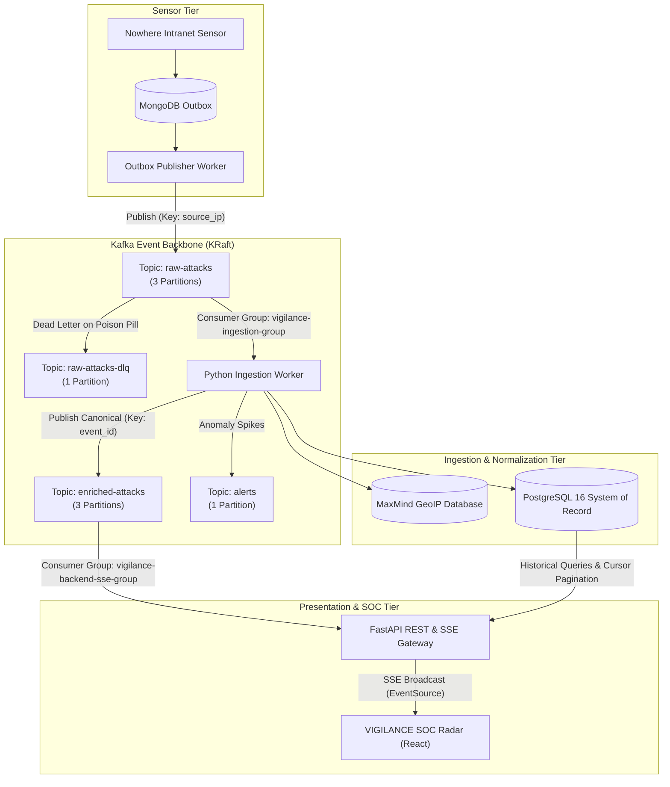

# VIGILANCE: Enterprise Deception & Threat Intelligence Platform

VIGILANCE is a distributed, production-grade cyber deception and real-time threat intelligence platform. It pairs an authentic public-facing target—**Nowhere Esports Intranet**—with an event-driven telemetry pipeline powered by **Apache Kafka (KRaft)**, asynchronous normalization workers, and a **Security Operations Center (SOC) Radar Dashboard** streaming live attack telemetry via Server-Sent Events (SSE).

---

## 1. Architectural Blueprint

```
                     ┌─────────────────────────────────────────────────────────┐
                     │               PUBLIC INTERNET & ATTACKERS               │
                     └────────────┬───────────────────────────────┬────────────┘
                                  │ HTTPS                         │ Web / API Probes
                                  ▼                               ▼
     ┌─────────────────────────────────────────────────────────────────────────┐
     │ DECEPTION TIER (Target Honeypot: Nowhere Esports Intranet)              │
     │ - Node.js + Express + EJS corporate tournament portal                   │
     │ - Real passwordless Gmail OTP verification via Resend API               │
     │ - Animated hide/unhide password controls & One Click Guest ID pass      │
     │ - Canary traps: /.env, /admin, SQLi, Log4Shell, Path Traversal          │
     │ - In-line Signature Engine & Contextual Severity Scorer (0 - 100)       │
     │ - MongoDB Evidence Store: Un-executed raw HTTP forensic captures        │
     │ - Transactional Outbox Publisher (Guarantees at-least-once delivery)    │
     └────────────────────────────────────┬────────────────────────────────────┘
                                          │ Partition Key: source_ip
                                          ▼
     ┌─────────────────────────────────────────────────────────────────────────┐
     │ KAFKA EVENT STREAMING BACKBONE (Apache Kafka in KRaft Mode)             │
     │ ├── raw-attacks       (3 Partitions, Key: source_ip)                    │
     │ ├── enriched-attacks  (3 Partitions, Key: event_id)                     │
     │ ├── alerts            (1 Partition,  Key: alert_type)                   │
     │ └── raw-attacks-dlq   (1 Partition,  Key: partition-offset)             │
     └─────────────────┬─────────────────────────────────────┬─────────────────┘
                       │                                     │
                       ▼                                     ▼
     ┌─────────────────────────────────┐   ┌───────────────────────────────────┐
     │ PIPELINE & INGESTION TIER       │   │ ANALYTICAL & PRESENTATION TIER    │
     │ - Python Ingestion Worker       │   │ - FastAPI REST API & SSE Gateway  │
     │ - MaxMind GeoIP City Resolution │   │ - HMAC-signed cursor pagination   │
     │ - PostgreSQL 16 Canonical Store │   │ - VIGILANCE SOC Radar Dashboard   │
     │ - Idempotent deduplication      │   │   (React + Vite + Tailwind SPA)   │
     └─────────────────────────────────┘   └───────────────────────────────────┘
```

---

## 2. Apache Kafka Event-Driven Architecture

VIGILANCE operates Apache Kafka 3.7+ in **KRaft (Kafka Raft Metadata)** mode, eliminating the ZooKeeper dependency while delivering sub-millisecond event propagation.



### Topic Topography & Keying Strategy

| Topic Name | Partitions | Partition Key | Ordering Guarantee | Purpose |
| :--- | :---: | :--- | :--- | :--- |
| `raw-attacks` | **3** | `source_ip` | Strict per-attacker temporal order | Ingests un-enriched sensor probe events from the Outbox Publisher. |
| `enriched-attacks`| **3** | `event_id` | Distributed load balancing | Carries canonical normalized attacks with GeoIP and rule context. |
| `alerts` | **1** | `alert_type` | Global linear ordering | Dispatches high-severity critical incident notifications. |
| `raw-attacks-dlq` | **1** | `partition-offset` | FIFO audit order | Dead-letter queue isolating schema-violating or malformed payloads. |

### Reliability & Resilience Principles
- **Transactional Outbox Pattern**: Web sensors write HTTP evidence and outbox records in the same MongoDB document context. A background publisher claims pending records with lease timeouts, preventing data loss during network blips.
- **Strict Idempotency**: The Ingestion Worker records processed `event_id` keys in PostgreSQL with `ON CONFLICT (event_id) DO NOTHING`. Replayed Kafka messages produce zero duplicate analytical metrics.
- **Poison Pill Isolation**: Corrupted JSON or schema-invalid events are diverted to `raw-attacks-dlq` with offset commits, protecting consumer lag from cascading head-of-line blocking.

---

## 3. Latest System Features & Updates

### Nowhere Esports Public Intranet (Decoy Target)
- **Authentic Esports Experience**: Fictional tournament brackets, schedule filters, live streaming player, team rosters, and rules across VALORANT, BGMI, Free Fire, and CS2.
- **Production Passwordless Auth**: Real-world 4-digit security code generation delivered to user inboxes using the **Resend API**.
- **Interactive Security Micro-Interactions**: Custom animated password visibility toggle with dark-mode screen blending.
- **One Click Pass**: Instant guest fan identity provisioning (`Join as a Guest ID →`) bypassing password requirements for casual users.
- **Zero-Demo Aesthetic**: Completely purged of emojis, "demo", "prototype", and "decoy" labels to maintain strict deception fidelity against sophisticated human adversaries.
- **Canary Honeytokens**: Instrumented canary traps (`/.env`, `/admin`, `/wp-login.php`, SQL injection vectors, Log4Shell JNDI injection) that capture forensic attacker metadata.

### VIGILANCE SOC Radar & Analytical Core
- **Live SSE Streaming**: Native W3C Server-Sent Events stream delivering sub-second attack notifications from Kafka straight to the SOC browser radar.
- **Real-Time Threat Scoring**: 14-category regex signature engine coupled with multi-factor contextual severity scoring (0–100).
- **HMAC Cursor Pagination**: High-throughput REST API supporting infinite scrolling and deterministic cursor navigation without database offset penalties.
- **Global GeoIP Analytics**: Automatic IP-to-City and Country code mapping with visual density maps and attack distribution breakdowns.

---

## 4. Verification & Testing Suites

The entire platform is backed by comprehensive automated test suites. **150 out of 150 tests pass** across all services.

```
Total Test Suites: 4
Total Automated Tests: 150 Passed (100% Green)
```

| Component | Framework | Tests | Key Capabilities Verified |
| :--- | :--- | :---: | :--- |
| **`apps/nowhere-intranet`** | Vitest | **75 Passed** | Regex signature detection, severity scoring, sensitive credential redaction (passwords, tokens), transactional outbox recovery, Kafka consumer offset commits, DLQ routing, honeypot canary routes (`/.env`, `/admin`, SQLi, Log4Shell, HTTP 413 body clamping). |
| **`services/backend`** | Pytest | **32 Passed** | Analytical queries, attack detail retrieval, UUID validation, HMAC cursor pagination bounds, SSE streaming broadcaster, health probes. |
| **`services/ingestion`** | Pytest | **30 Passed** | Idempotent PostgreSQL inserts (`ON CONFLICT`), GeoIP city resolution, schema migration validation, outbox publisher concurrency, broker failure recovery. |
| **`apps/dashboard`** | Vitest | **13 Passed** | SSE client connection state, live attack feed re-rendering, severity chart computations, summary analytics cards. |

### Running the Test Suites

```bash
# Nowhere Intranet (75 tests)
npm --prefix apps/nowhere-intranet test

# Analytical Backend API (32 tests)
cd services/backend && pytest -q

# Ingestion Worker (30 tests)
cd services/ingestion && pytest -q

# SOC Dashboard (13 tests)
npm --prefix apps/dashboard test -- --run
```

---

## 5. Cloud Deployment Guide: Azure + Netlify / Vercel

The production architecture isolates the **VIGILANCE Defense Core & Decoy Intranet** on a single cloud host (**Microsoft Azure**), while serving the **SOC Dashboard Radar** over edge CDN (**Netlify** or **Vercel**).

```
[Netlify / Vercel] ────────► [Microsoft Azure Gateway (Port 80/443)]
SOC Radar Dashboard           ├── Nowhere Esports Decoy Site (Port 3000)
(Vite / React SPA)            └── FastAPI REST & SSE Backend (Port 8000)
                                   ├── Ingestion Worker (Python)
                                   ├── Apache Kafka (KRaft)
                                   ├── MongoDB 7.0 (Evidence)
                                   └── PostgreSQL 16 (Metrics)
```

### Step 1: Deploy VIGILANCE Core on Microsoft Azure

1. Provision an **Azure Virtual Machine** (`Ubuntu 22.04 LTS`, size `Standard_B2s` or `Standard_D2s_v5`).
2. Open inbound ports **80 (HTTP)**, **443 (HTTPS)**, and **22 (SSH)** in your Azure Network Security Group.
3. SSH into your Azure VM and clone the repository:
   ```bash
   git clone https://github.com/probanjee/Honeypot-System.git
   cd Honeypot-System
   ```
4. Configure your production environment:
   ```bash
   cp .env.example .env
   nano .env
   ```
   *Provide your `RESEND_API_KEY` and choose strong database credentials.*
5. Launch all 7 containers with one command:
   ```bash
   docker compose -f docker-compose.prod.yml up -d --build
   ```

Your Nowhere Esports website is now live on `http://<AZURE_PUBLIC_IP>/`, and your Backend REST/SSE API is available at `http://<AZURE_PUBLIC_IP>/api/v1/`.

### Step 2: Deploy the SOC Radar to Vercel or Netlify

#### Option A: Vercel
1. Import `probanjee/Honeypot-System` on [Vercel](https://vercel.com).
2. Configure project:
   - **Framework Preset**: `Vite`
   - **Root Directory**: `apps/dashboard`
   - **Build Command**: `npm run build`
   - **Output Directory**: `dist`
3. Set Environment Variable:
   - `VITE_API_BASE_URL` = `http://<AZURE_PUBLIC_IP>` (or your custom domain `https://api.yourdomain.com`).
4. Click **Deploy**.

#### Option B: Netlify
1. Import `probanjee/Honeypot-System` on [Netlify](https://netlify.com).
2. Configure settings:
   - **Base directory**: `apps/dashboard`
   - **Build command**: `npm run build`
   - **Publish directory**: `apps/dashboard/dist`
3. Set Environment Variable:
   - `VITE_API_BASE_URL` = `http://<AZURE_PUBLIC_IP>`
4. Click **Deploy site**.

For complete domain DNS, SSL (Let's Encrypt), and reverse proxy setup instructions, see [`docs/operations/deployment-guide.md`](file:///c:/Users/prosu/OneDrive/Desktop/Honeypot-System/docs/operations/deployment-guide.md).

---

## 6. Directory Structure

```text
Honeypot-System/
├── .gitignore                          # Excludes secrets, node_modules, and cache
├── README.md                           # Master architectural blueprint & documentation
├── docker-compose.yml                  # Local development infrastructure compose
├── docker-compose.prod.yml             # Full production cloud compose (Azure)
├── deploy/
│   └── nginx/
│       └── nginx.conf                  # Production reverse proxy with SSE streaming
├── docs/
│   ├── architecture/                   # System design, data flows, and ADRs
│   ├── api/                            # Kafka topic specifications and event schemas
│   └── operations/
│       └── deployment-guide.md         # Step-by-step Azure & Netlify/Vercel deployment guide
├── apps/
│   ├── nowhere-intranet/               # Decoy Express esports tournament honeypot
│   │   ├── Dockerfile                  # Multi-stage production container
│   │   ├── src/views/                  # EJS templates (Home, Tournaments, Portal, Login)
│   │   └── src/routes/                 # Web routes, auth endpoints, and honeypot traps
│   └── dashboard/                      # VIGILANCE React + Vite + Tailwind SOC Radar
│       ├── Dockerfile                  # Production container
│       ├── vercel.json                 # Vercel SPA routing
│       └── netlify.toml                # Netlify build configuration
└── services/
    ├── backend/                        # FastAPI REST & SSE streaming server
    │   └── Dockerfile                  # Production container
    └── ingestion/                      # Python Kafka consumer & GeoIP worker
        └── Dockerfile                  # Production container
```
