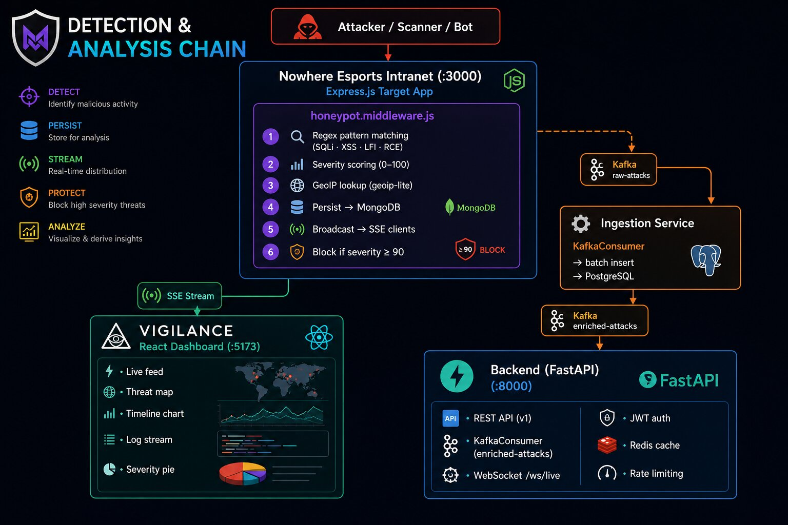

<div align="center">

# VIGILANCE

**Enterprise Honeypot Platform**

[](https://www.python.org/)
[](https://nodejs.org/)
[](https://react.dev/)
[](https://fastapi.tiangolo.com/)
[](https://kafka.apache.org/)
[](https://www.docker.com/)
[](LICENSE)

A deception-driven security platform that deploys high-fidelity honeypot services,
captures attacker behaviour in real time, and surfaces actionable threat intelligence
through an event-driven microservices pipeline.

</div>

---

## How It Works

VIGILANCE pairs a purpose-built **target application** (Nowhere Esports Intranet) with a backend **detection and analysis pipeline**. Every HTTP request that hits the target passes through a signature-matching middleware. When a malicious pattern is identified, the event is persisted to MongoDB, broadcast over SSE to the dashboard, and simultaneously pushed into Apache Kafka for downstream enrichment, anomaly detection, and alerting.

---

## Architecture Documentation

The upgraded target-state architecture for the Nowhere Esports Intranet is documented in [docs/nowhere-esports-intranet-architecture.md](./docs/nowhere-esports-intranet-architecture.md). It defines the planned React/Vite/TypeScript frontend, Express API, Supabase PostgreSQL/Auth/Realtime/Storage design, RBAC/RLS model, deception assets, VIGILANCE telemetry flow, API catalog, deployment plan, roadmap, and testing strategy.

---

## Detection & Analysis Chain



---

## Kafka Topic Pipeline

The platform uses **three Kafka topics** as its central nervous system. Each topic represents a stage in the processing chain:

```
raw-attacks ──────────┬────────────────── enriched-attacks ──────── alerts
                      │                          │                     │
          ┌───────────┴───────────┐    ┌─────────┴─────────┐   ┌─────┴──────────┐
          │   Ingestion Service   │    │  Analytics Service │   │ Alerting Svc   │
          │                       │    │                    │   │                 │
          │ • Batch consume       │    │ • 5-min sliding    │   │ • Slack webhook │
          │ • Sanitize payload    │    │   window (pandas)  │   │ • PagerDuty     │
          │ • GeoIP enrich        │    │ • MAD anomaly      │   │ • Severity gate │
          │ • Insert → Postgres   │    │   detection        │   │   HIGH → Slack  │
          │                       │    │ • Publish alerts    │   │   CRIT → Pager  │
          └───────────────────────┘    └────────────────────┘   └────────────────┘
                      │
          ┌───────────┴───────────┐
          │  Threat Intel Service │
          │                       │
          │ • AbuseIPDB lookup    │
          │ • Shodan recon        │
          │ • IP dedup cache      │
          └───────────────────────┘
```

**Topic breakdown:**

| Topic | Producer | Consumers | Purpose |
|---|---|---|---|
| `raw-attacks` | Honeypot middleware, SSH/HTTP probes | Ingestion, Threat Intel | Unprocessed attack events straight from sensors |
| `enriched-attacks` | Ingestion Service | Backend, Analytics | Attacks enriched with GeoIP data, cleaned payloads |
| `alerts` | Analytics Service | Alerting Service | Anomaly alerts generated from statistical analysis |

---

## Signature Engine

Attack classification is driven by a YAML-based rule set (`configs/honeypot-rules.yaml`) containing **14 weighted signatures**:

| Signature | Weight | Example Match |
|---|---|---|
| SQL Injection | 25 | `UNION SELECT`, `DROP TABLE`, `1=1` |
| SQL Injection Advanced | 30 | `benchmark(`, `pg_sleep`, `information_schema` |
| XSS | 20 | `<script>`, `onerror=`, `javascript:` |
| Path Traversal | 35 | `../../`, `/etc/passwd`, `C:\Windows\System32` |
| Command Injection | 40 | `; ls`, `&& cat`, `` `whoami` `` |
| Log4Shell (CVE-2021-44228) | 50 | `${jndi:ldap:` |
| PHP RCE | 45 | `eval(`, `shell_exec(`, `system(` |
| Shellshock (CVE-2014-6271) | 40 | `() { :; };` |
| Sensitive File Access | 30 | `.env`, `.git/config`, `.aws/credentials` |
| NoSQL Injection | 25 | `$gt`, `$ne`, `$where` |
| XXE | 35 | `<!ENTITY`, `SYSTEM "file:` |
| SSTI | 30 | `{{...}}`, ``, `${...}` |
| Network Scanner | 5 | `Nmap`, `Zgrab`, `Masscan`, `nuclei` |
| Credential Stuffing | 20 | `admin:admin`, `root:root` |

Weights accumulate per request and are clamped to a 0–100 severity score. Additional heuristics boost severity for SSH protocol (+15), oversized payloads (+10), and dangerous keywords (+5).

---

## Services

| Service | Stack | Port | What it does |
|---|---|---|---|
| **Nowhere Esports Intranet** | Node.js, Express, MongoDB, Passport | `3000` | Target application. Serves the fake corporate site and runs the honeypot middleware on every inbound request. |
| **VIGILANCE Dashboard** | React 18, TypeScript, Vite, Recharts | `5173` | Real-time SPA. Connects to the target via SSE and renders live attack feed, threat globe, timeline, severity analytics. |
| **Backend API** | Python, FastAPI, SQLAlchemy, asyncpg | `8000` | REST API for the dashboard. Consumes enriched attacks from Kafka, persists to PostgreSQL, exposes WebSocket for live push. |
| **Ingestion** | Python, kafka-python, asyncpg | — | Batch consumer on `raw-attacks`. Cleans payloads, enriches with GeoIP (MaxMind), bulk inserts to PostgreSQL. |
| **Analytics** | Python, pandas, numpy, kafka-python | — | Sliding-window anomaly detection using Median Absolute Deviation (MAD). Publishes `TRAFFIC_SPIKE` alerts to Kafka. |
| **Threat Intel** | Python, aiohttp, kafka-python | — | Concurrent IP enrichment against AbuseIPDB and Shodan APIs. Deduplicates with an in-memory IP cache. |
| **Alerting** | Python, aiohttp, kafka-python | — | Consumes the `alerts` topic. Routes HIGH-severity events to Slack via webhook, CRITICAL to PagerDuty. |
| **API Gateway** | Nginx | `80` | Reverse proxy. Routes `/api/*` → Backend, `/ws/*` → WebSocket upgrade, `/*` → Frontend. |

---

## Data Stores

| Store | Role |
|---|---|
| **PostgreSQL 15** | Primary relational store. Attack records, sessions, user accounts. Async access via `asyncpg`. |
| **MongoDB** | Document store on the target side. Raw attack logs persisted by the honeypot middleware. |
| **Redis 7** | Cache layer and rate-limiter. Sliding-window counters for API rate limiting, JSON response caching with configurable TTL. |
| **Apache Kafka** | Event backbone. Decouples producers (honeypots) from consumers (ingestion, analytics, alerting, backend). |
| **Supabase** | Cloud Postgres / Auth system (Optional integration via `USE_SUPABASE=true` feature flag). |

---

## Quick Start

```bash
# clone
git clone <repo-url> && cd honeypot

# install
cd nowhere-esports-intranet && npm install && cd ..
cd honeypot-platform/frontend && npm install && cd ../..

# configure
cp honeypot-platform/.env.example honeypot-platform/.env

# run (Windows)
start_project.bat

# or run with Docker (all services)
cd honeypot-platform && docker compose up -d
```

| Endpoint | URL |
|---|---|
| Target Site | `http://localhost:3000` |
| Dashboard | `http://localhost:5173` |
| API | `http://localhost:8000` |
| Swagger Docs | `http://localhost:8000/docs` |

---

## Project Layout

```
honeypot/
├── honeypot-platform/
│   ├── frontend/src/               # React dashboard
│   │   ├── features/               # attacks, analytics, logs, threats
│   │   ├── hooks/                  # useHoneypotStream (SSE + stats polling)
│   │   └── styles/                 # globals.css
│   ├── services/
│   │   ├── backend/app/            # FastAPI — api/, core/, models/, repositories/, services/
│   │   ├── ingestion/              # Kafka consumer → PostgreSQL batch writer
│   │   ├── analytics/              # MAD anomaly detection → alert publisher
│   │   ├── threat-intel/src/       # AbuseIPDB + Shodan enrichment
│   │   ├── alerting/               # Slack / PagerDuty dispatcher
│   │   ├── honeypots/              # base/ · ssh/ · http/ probe services
│   │   └── api-gateway/            # Nginx reverse proxy
│   ├── shared/                     # kafka_producer, logger, geoip, exceptions
│   ├── configs/                    # honeypot-rules.yaml, dev.yaml, prod.yaml
│   ├── tests/                      # Unit & integration tests
│   ├── deployments/                # Kubernetes manifests
│   ├── infrastructure/             # Terraform IaC
│   ├── migrations/                 # DB migration scripts
│   └── docker-compose.yml          # Full stack orchestration (12 services)
│
├── nowhere-esports-intranet/
│   └── server/                     # Express app, controllers, middleware, models, routes
│       ├── middleware/honeypot.middleware.js   # ← the detection engine
│       └── models/AttackLog.model.js          # ← MongoDB schema
│
└── start_project.bat               # One-click launcher
```

---

## Roadmap

| Feature | Status |
|---|---|
| ML-based anomaly detection (replace MAD with trained models) | Planned |
| Dynamic honeypot spawning on perimeter probe detection | Planned |
| MITRE ATT&CK TTP mapping from captured signatures | Planned |
| Canary token system (embedded tracking in fake documents) | Planned |
| 3D WebGL threat globe (replace 2D map) | Planned |
| Multi-tenant architecture for MSP deployments | Planned |
| SOAR playbook integration (auto-block, tarpit, isolate) | Planned |

---

## License

MIT

