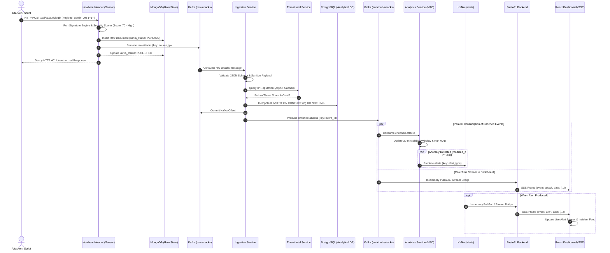

# VIGILANCE: End-to-End Data Flow Specification

## 1. Lifecycle of an Intrusion Attempt

The following diagram traces the end-to-end flow of an exploit attempt from arrival at the sensor to live rendering on the SOC dashboard.

---

## 2. Step-by-Step Data Transformations

### Step 1: Capture and Redaction (Sensor Edge)
- **Input**: Raw Node.js `IncomingMessage` object (method, headers, query, body).
- **Processing**:
  - Request body bounded to 4096 bytes.
  - Sensitive authentication tokens (`Authorization`, `Cookie`, `password`, `token`) masked to `[REDACTED_SECRET]`.
  - Signature engine scans path, query, headers, and body against `configs/honeypot-rules.yaml`.
  - Severity scorer computes multi-factor score (0–100).
  - Assigned `event_id = uuidv4()`.
- **Output**: JSON payload saved to MongoDB and published to `raw-attacks`.

### Step 2: Canonical Normalization (Ingestion Service)
- **Input**: Message from `raw-attacks`.
- **Processing**:
  - Pydantic model validation (`RawAttackEventSchema`).
  - IP classification: Check if IP is private (RFC 1918) vs public.
  - GeoIP resolution (MaxMind local db) -> Country, City, Coordinates.
  - Optional Threat Intel resolution -> AbuseIPDB score.
- **Output**: Relational row in PostgreSQL `attacks` table and JSON published to `enriched-attacks`.

### Step 3: Statistical Aggregation (Analytics Service)
- **Input**: Message from `enriched-attacks`.
- **Processing**:
  - Appended to chronological in-memory ring buffer of 1-minute time buckets.
  - Window evaluation: 30 1-minute buckets evaluated via MAD algorithm.
  - Anomaly determination: If current bucket modified z-score $\ge 3.5$, an alert is constructed.
- **Output**: JSON published to `alerts`.

### Step 4: Presentation Streaming (FastAPI Backend)
- **Input**: Stream of enriched attacks and alerts.
- **Processing**: Packaged into SSE frames (`text/event-stream`) with sequential `id: <event_id>`.
- **Output**: Live browser state updates without full-page reloads.
