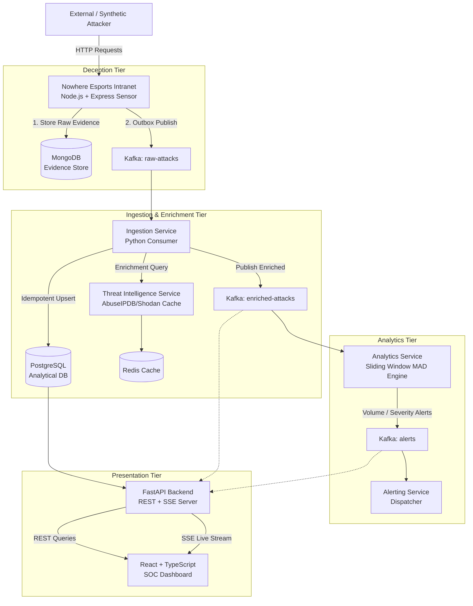

# VIGILANCE: System Overview & Architecture

## 1. Executive Summary
**VIGILANCE** is an enterprise-grade deception engineering and real-time security monitoring platform. It combines:
1. An instrumented corporate decoy intranet (**Nowhere Esports Intranet**) serving realistic web routes, decoys, and traps.
2. An in-line request interception and signature engine capable of bounded payload normalization and multi-pattern matching across 14 distinct attack categories.
3. A dual-store evidence and analytical persistence model (MongoDB for raw forensic telemetry, PostgreSQL for canonical indexed analytics).
4. An Apache Kafka event backbone orchestrating streaming telemetry across decoupled microservices.
5. An explainable statistical anomaly detection engine utilizing Median Absolute Deviation (MAD).
6. A high-performance FastAPI backend delivering REST queries and live Server-Sent Events (SSE) updates to a React/TypeScript SOC dashboard.

---

## 2. Component Topology

---

## 3. The Three Kafka Topics

| Topic Name | Producer Service | Consumer Services | Message Key | Semantic Guarantee |
| :--- | :--- | :--- | :--- | :--- |
| `raw-attacks` | Nowhere Esports Sensor | Ingestion Service | `source_ip` | At-least-once, FIFO per IP |
| `enriched-attacks` | Ingestion Service | Analytics Service, Backend API | `event_id` | At-least-once, Uniform hash |
| `alerts` | Analytics Service | Alerting Service, Backend API | `alert_type` | At-least-once, Global FIFO |

---

## 4. Key Design Principles

1. **Defense in Depth**: Attack payloads captured by sensors are strictly treated as toxic un-executable text. Payloads are bounded, sanitized, and never evaluated via `eval()`, template engines, or unparameterized queries.
2. **Decoupled Asynchrony**: If downstream PostgreSQL or Redis experiences downtime, the sensor continues serving decoy responses and captures evidence safely into MongoDB and Kafka.
3. **Idempotency Everywhere**: Downstream consumers assume duplicate deliveries will occur. All analytical writes use deterministic primary keys and `ON CONFLICT DO NOTHING`.
4. **Explainability Over Obscurity**: Anomaly detection alerts produce explicit mathematical proofs (median, MAD, modified z-score, window size) instead of uncalibrated neural confidence scores.

---

## 5. Nowhere Esports Intranet Decoy Specification

The decoy honeypot (`apps/nowhere-intranet`) simulates an internal portal for a fictional esports enterprise:
- **EJS Server-Rendered Views**: Homepage (`/`), Tournament Listings (`/tournaments`), Staff Directory (`/staff/directory`), Player Login (`/login`), and Decoy Admin Portal (`/admin/login`).
- **Mock JSON REST APIs**: `/api/v1/tournaments`, `/api/v1/tournaments/:id`, `/api/v1/staff`, and `/api/v1/staff/:id`.
- **Canary Traps & Honeytokens**: Decoy routes specifically designed to attract reconnaissance tools and scanners: `/.env`, `/admin`, `/admin/config`, `/actuator`, `/backup/`, and `/robots.txt`.
- **Request Bounding & Safe Handling**: Express enforces a strict 4KB request body limit. Inputs are never passed to shell commands, databases, or evaluated dynamically.
- **Repository Abstraction (`IEvidenceRepository`)**: The sensor interacts with persistence exclusively via `IEvidenceRepository`. In local development and integration tests, `MongoEvidenceRepository` connects to MongoDB 7 (`127.0.0.1:27017`) and fails fast on connection errors. In unit tests, `MockEvidenceRepository` provides isolated in-memory verification.

