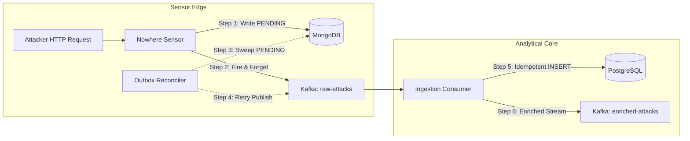

# Learning Guide 01: System Fundamentals & Distributed Deception Architecture

## 1. Learning Objectives
By studying this module, you will:
- Understand how modern deception systems differ from traditional intrusion detection systems (IDS/IPS).
- Analyze the architectural trade-offs between synchronous REST calls, direct database writes, and asynchronous event streams via Apache Kafka.
- Understand the CAP Theorem, at-least-once delivery semantics, and idempotent consumer design.
- Learn why dual writes between databases and message brokers fail, and how the transactional outbox reconciler fixes it.
- Confidently answer senior distributed systems interview questions regarding Kafka and distributed persistence.

---

## 2. Prerequisite Knowledge
- Basic networking: IP addresses, TCP handshakes, HTTP methods and status codes.
- Relational DBMS basics: SQL transactions (`BEGIN`, `COMMIT`, `ROLLBACK`), ACID properties.
- Concurrency basics: Processes vs. threads, asynchronous event loops (Node.js / Python `asyncio`).

---

## 3. Plain-Language Explanation
Imagine a decoy bank branch built specifically to study bank robbers:
- The tellers (Honeypot Sensor) are actors. When a robber hands over a threatening note, the teller complies outwardly and secretly writes down every word on an incident slip (MongoDB raw evidence).
- If the teller picked up a landline phone to call the chief of police for permission before every response, the robber would notice the delay and run away (synchronous coupling).
- Instead, the teller drops the incident slip into a pneumatic dispatch tube (Kafka `raw-attacks`).
- The dispatch tube whisks the slip to an intelligence office (Ingestion Service) where detectives cross-reference the handwriting, stamp it into the city police ledger (PostgreSQL), and alert patrol units (Analytics Service & Dashboard).
- Even if the intelligence office power fails for 5 minutes, the pneumatic tube buffers the slips safely without losing a single clue.

---

## 4. The Technical Explanation

### 4.1 Synchronous Monolith vs. Event-Driven Microservices
In a naive architecture, the HTTP honeypot would:
1. Receive an HTTP request.
2. Parse signatures.
3. Call MaxMind GeoIP.
4. Call AbuseIPDB over the public internet ($300\text{ms} - 1500\text{ms}$ latency).
5. Run complex statistical queries against SQL.
6. Insert into PostgreSQL.
7. Return HTTP 401.

**Why this fails in production**:
- The attacker experiences a $2$-second response delay. Automated scanners immediately flag this as an anomaly, revealing the honeypot sensor ("Honeypot Fingerprinting").
- If AbuseIPDB has an outage, the honeypot crashes or times out.
- High-volume traffic saturates the database connection pool, starving the entire system.

In VIGILANCE:
- The Honeypot sensor performs **zero external network calls** and returns immediately ($< 15\text{ms}$).
- Heavy processing (GeoIP, Threat Intel, SQL indexing, MAD statistics) is completely offloaded to background microservices connected via Kafka.

### 4.2 The Dual-Write Problem
When an application must update a database and publish a message to a message broker, no distributed transaction exists across heterogeneous systems without two-phase commit (2PC) or an outbox pattern:
```
// VULNERABLE CODE:
await mongoDb.collection('raw_attacks').insertOne(evidence); // Succeeded
// <-- What if the server crashes right here, or network to Kafka fails?
await kafkaProducer.send({ topic: 'raw-attacks', messages: [...] }); // Never called!
```
If step 2 fails, the evidence exists in MongoDB, but the rest of the enterprise never knows the attack happened.

**Solution: The Transactional Outbox Pattern**:
1. Save the document with `kafka_status: "PENDING"`.
2. Try immediate publish; if successful, update to `"PUBLISHED"`.
3. An in-process reconciler worker queries for `PENDING` records older than 10 seconds and re-publishes with exponential backoff.

---

## 5. Why the Concept Matters in VIGILANCE
Deception sensors are inherently exposed to adversarial, hostile conditions. Attackers may attempt denial-of-service, flood the server with garbage bytes, or abruptly close TCP sockets. Decoupling ingestion via Kafka and securing persistence via the outbox reconciler guarantees 100% forensic survivability.

---

## 6. Architecture Diagram



---

## 7. Actual Code References
- Configuration: `configs/system-config.yaml`
- Rules: `configs/honeypot-rules.yaml`
- Decision Record: `docs/architecture/decision-records/ADR-001-canonical-records-and-dual-writes.md`
- Schema: `docs/database/schema.md`

---

## 8. Step-by-Step Execution Walkthrough
1. **Request Ingress**: `POST /api/v1/auth/login` arrives at Node.js HTTP server.
2. **Buffer Inspection**: Body parser reads up to 4096 bytes; remaining bytes truncated.
3. **Regex Scanning**: Engine runs 14 regex patterns against path, query, headers, and body.
4. **Scoring**: Base weights + context modifiers calculated (Score: 75 -> HIGH).
5. **MongoDB Persistence**: Mongoose creates `RawEvidence` document with `kafka_status: "PENDING"`.
6. **Kafka Dispatch**: KafkaJS producer dispatches to partition `hash(source_ip) % 3` in `raw-attacks`.
7. **Decoy Response**: Express sends decoy `{ "error": "Invalid credentials", "code": 401 }`.
8. **Ingestion Consumption**: Python worker receives event, confirms schema, writes to PostgreSQL with `ON CONFLICT (id) DO NOTHING`.

---

## 9. Input and Output Examples

### Sample Input (Attacker Request)
```http
POST /api/v1/users?id=1%20UNION%20SELECT%20null,password_hash%20FROM%20users-- HTTP/1.1
Host: intranet.nowhere.gg
User-Agent: sqlmap/1.7.2#stable
Content-Type: application/json

{"role": "analyst"}
```

### Sample Output (Kafka `raw-attacks` Record)
```json
{
  "event_id": "a93c72e1-45bd-4a0b-80a1-c7c10b7842ef",
  "mongo_raw_id": "671ad29e4f1a2b3c4d5e6f70",
  "schema_version": "1.0.0",
  "timestamp": "2026-10-24T23:30:00.123Z",
  "event_type": "RAW_ATTACK_DETECTED",
  "source": { "ip": "185.220.101.5", "port": 49123 },
  "detection": {
    "severity_score": 75,
    "severity_level": "HIGH",
    "matched_rules": [
      { "rule_id": "SIG-SQLI-002", "rule_name": "Advanced SQL Injection", "category": "SQL_INJECTION", "weight": 45 },
      { "rule_id": "SIG-SCAN-001", "rule_name": "Automated Security Scanner", "category": "SCANNER", "weight": 25 }
    ]
  },
  "request": {
    "method": "POST",
    "path": "/api/v1/users",
    "protocol": "HTTP/1.1",
    "headers": { "user-agent": "sqlmap/1.7.2#stable", "host": "intranet.nowhere.gg" },
    "raw_payload": "{\"role\": \"analyst\"}",
    "truncated": false
  }
}
```

---

## 10. Important Algorithms & Complexity
- **Partition Selection**: $P = \text{murmur2}(\text{key}) \pmod{\text{num\_partitions}}$. Time complexity: $O(K)$ where $K$ is key length.
- **Deduplication**: B-Tree primary key index lookup on PostgreSQL `id UUID`. Time complexity: $O(\log M)$ where $M$ is total attack records.

---

## 11. Failure Scenarios

| Failure Event | System Response | Recovery Mechanism |
| :--- | :--- | :--- |
| **Kafka Broker Down** | Sensor logs warning; MongoDB status stays `PENDING`. Decoy HTTP requests succeed without crashing. | Outbox worker automatically retries when broker resumes. |
| **PostgreSQL Down** | Ingestion service consumer pauses Kafka offset commits and retries with backoff. | Once PostgreSQL recovers, consumer resumes without message loss. |
| **Poison Pill Message (Corrupt JSON)** | Validation fails in Ingestion Service. | Message routed to `raw-attacks-dlq`; consumer commits offset to prevent pipeline freeze. |

---

## 12. Security Implications
1. **Never Trust Captured Payloads**: Captured inputs may contain exploit payloads targeting vulnerabilities in the logging pipeline itself (e.g. Log4Shell targeting Java loggers, or SQL injection targeting PostgreSQL).
2. **Parameterized Queries**: All PostgreSQL inserts use bound parameters (`$1, $2, ...`), completely neutralizing any SQL injection payload contained inside the captured attack text.

---

## 13. Performance Trade-offs
- **Batching vs Latency**: The Kafka producer in Node.js buffers messages for up to 10ms (`linger.ms = 10`) to create efficient network batches. This trade-off slightly delays event delivery by 10ms but multiplies network throughput by $5\times$.

---

## 14. Common Misconceptions
- **Misconception**: *"Setting `enable.idempotence = true` on Kafka Producer gives end-to-end exactly-once processing."*
  - **Reality**: Producer idempotence only prevents duplicates between the producer and the broker log (e.g. network ACK lost). If the downstream consumer crashes after writing to the database but before committing its Kafka offset, the message will be delivered again. Downstream consumers **must** be idempotent.

---

## 15. Troubleshooting Instructions
1. **Check Kafka Consumer Lag**:
   ```bash
   kafka-consumer-groups.sh --bootstrap-server localhost:9092 --group vigilance-ingestion-group --describe
   ```
2. **Inspect MongoDB Pending Outbox**:
   ```javascript
   db.raw_evidence.countDocuments({ kafka_status: "PENDING" });
   ```

---

## 16. Practical Exercises
1. Trace what happens when you publish an event with a duplicated `event_id` directly to `raw-attacks`. Run a query in PostgreSQL to verify that only a single row exists.
2. Simulate a broker failure by stopping Kafka, making 5 HTTP requests to the decoy, verifying they are in MongoDB with `kafka_status: "PENDING"`, starting Kafka, and watching the outbox reconciler publish all 5.

---

## 17. Interview Questions & Model Answers

### Question 1: How do you handle the dual-write problem between your database and Kafka?
**Model Answer**:
> In VIGILANCE, writing to MongoDB and publishing to Kafka cannot be coordinated via a distributed transaction because they are heterogeneous storage systems. If we write to MongoDB and the process crashes before publishing to Kafka, telemetry is lost. We solve this using the Transactional Outbox Pattern: the honeypot writes the raw evidence to MongoDB with `kafka_status: "PENDING"`. It then asynchronously sends the message to Kafka. If Kafka responds with an ACK, the status is updated to `"PUBLISHED"`. An asynchronous in-process reconciler scans for any records remaining in `PENDING` state after 10 seconds and re-publishes them with exponential backoff. Downstream, the ingestion service performs idempotent SQL `INSERT ... ON CONFLICT (id) DO NOTHING` using the event's UUIDv4 identifier to ensure duplicate deliveries are safely ignored.

### Question 2: Why choose KRaft mode over ZooKeeper for Kafka deployment?
**Model Answer**:
> Apache Kafka historically relied on ZooKeeper for leader election, topic configuration, and cluster metadata. ZooKeeper operated as a separate stateful cluster, requiring separate JVM memory, synchronization logic, and independent networking, which often became a bottleneck and a dual-point of failure. KRaft (Kafka Raft Metadata mode) integrates consensus directly into the Kafka broker using an event-driven Raft protocol. Metadata changes are committed to an internal Kafka log partition (`@metadata`), enabling instant failovers, lower operational complexity, and simpler container orchestration.

---

## 18. Knowledge Check Section
1. What is the role of `source_ip` as the message key in the `raw-attacks` Kafka topic?
2. Why is Server-Sent Events (SSE) preferred over WebSockets for the VIGILANCE SOC dashboard?
3. What happens when an incoming request contains a payload larger than 4096 bytes?

---

## 19. References to Official Documentation
- [Apache Kafka Documentation (KRaft Mode)](https://kafka.apache.org/documentation/#kraft)
- [PostgreSQL Documentation on Indexes and ON CONFLICT](https://www.postgresql.org/docs/current/sql-insert.html)
- [Node.js Event Loop Architecture](https://nodejs.org/en/docs/guides/event-loop-timers-and-nexttick/)
- [RFC 1918: Address Allocation for Private Internets](https://datatracker.ietf.org/doc/html/rfc1918)
