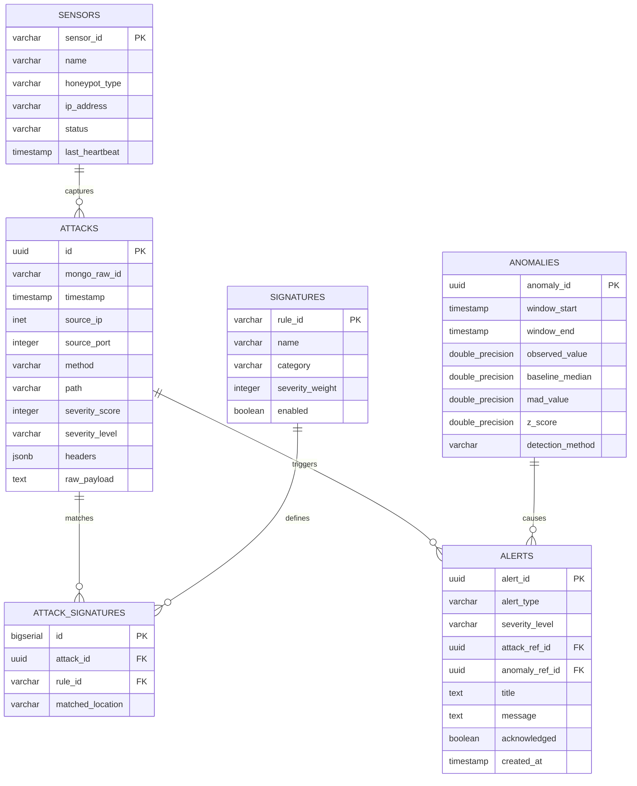

# Learning Guide 07: Polyglot Persistence with PostgreSQL & MongoDB

## 1. Learning Objectives
By completing this guide, you will:
1. Master the engineering rationale behind **Polyglot Persistence** (using multiple database engines for specialized workloads).
2. Understand why storing raw security payloads in relational tables creates performance and maintenance bottlenecks.
3. Learn how **MongoDB** handles variable, unstructured, and forensic HTTP payload evidence.
4. Learn how **PostgreSQL** serves as the canonical source of truth for normalized analytics, relational joins, and ACID compliance.
5. Understand the foreign reference pattern (`raw_evidence_ref`) connecting PostgreSQL records to MongoDB evidence documents.
6. Master advanced indexing strategies: B-Tree, BRIN (time-series), GIN (JSONB), and partial indexes.

---

## 2. Polyglot Persistence: Why Two Databases?

In software engineering, attempting to force all application data into a single database paradigm is an antipattern known as "Golden Hammer Syndrome."

| Requirement | Relational DB (PostgreSQL) | Document Store (MongoDB) |
| :--- | :--- | :--- |
| **Primary Strength** | Strict schemas, relational integrity, complex analytical SQL queries. | Flexible schemas, high-throughput document ingestion, large binary/text blobs. |
| **Schema Evolution** | Requires explicit migrations (`ALTER TABLE`). Adding columns during heavy load can lock tables. | Dynamic. Each document can have arbitrary nested keys and unstructured fields. |
| **Forensic Evidence** | Cumbersome to store arbitrary HTTP payloads, malformed headers, and multi-megabyte request bodies. | Ideal for storing verbatim HTTP requests as JSON/BSON documents. |
| **Analytical Queries** | Exceptional: Aggregations, window functions, time-bucket bucketing (`date_trunc`), percentiles. | Good for document retrieval, but slower on complex multi-table joins. |
| **Role in VIGILANCE** | **Canonical Analytics & Reporting Store** | **Raw Forensic Evidence & Outbox Store** |

---

## 3. MongoDB: Raw Forensic Evidence Layer

### 3.1 Responsibilities
1. **Verbatim Capture**: Captures the exact HTTP request as observed by the honeypot sensor, including unusual HTTP verbs (`PROPFIND`, `SEARCH`), malformed headers, multipart uploads, and binary payloads.
2. **Outbox Log**: Serves as the immediate persistent write target for the honeypot sensor before asynchronous dispatch to Kafka.
3. **Automated Evidence Lifecycle**: Utilizes MongoDB **TTL (Time-To-Live) Indexes** to automatically expire and delete historical evidence documents after 30 days without manual cron maintenance.

### 3.2 Evidence Collection Schema (`raw_evidence`)
```json
{
  "_id": ObjectId("6537f1a2b3c4d5e6f7a8b9c0"),
  "event_id": "550e8400-e29b-41d4-a716-446655440000",
  "sensor_id": "honeypot-nowhere-01",
  "timestamp": ISODate("2026-10-24T18:00:00.000Z"),
  "publish_status": "PUBLISHED",
  "published_at": ISODate("2026-10-24T18:00:00.120Z"),
  "request": {
    "method": "POST",
    "url": "/admin/config/upload",
    "http_version": "1.1",
    "headers": {
      "host": "intranet.nowhere-esports.local",
      "user-agent": "Mozilla/5.0 (compatible; EvilScan/2.0)",
      "content-type": "application/x-yaml",
      "x-forwarded-for": "198.51.100.23",
      "authorization": "Bearer [REDACTED_BY_SENSOR]"
    },
    "query": {},
    "body_raw": "!!javax.script.ScriptEngineManager [ ... payload ... ]",
    "body_parsed": null,
    "payload_size_bytes": 1048
  },
  "client": {
    "remote_ip": "198.51.100.23",
    "remote_port": 54321
  },
  "signature_matches": [
    {
      "rule_id": "SIG-CODE-001",
      "category": "CODE_INJECTION",
      "matched_location": "request.body_raw",
      "extracted_sample": "ScriptEngineManager"
    }
  ]
}
```

### 3.3 MongoDB Indexing Strategy
```javascript
// 1. Unique index on event_id for fast lookup from PostgreSQL reference
db.raw_evidence.createIndex({ "event_id": 1 }, { unique: true });

// 2. Compound index for Outbox reconciler worker
db.raw_evidence.createIndex({ "publish_status": 1, "timestamp": 1 });

// 3. TTL Index to automatically delete evidence older than 30 days
db.raw_evidence.createIndex({ "timestamp": 1 }, { expireAfterSeconds: 2592000 });
```

---

## 4. PostgreSQL: Canonical Analytical Store

### 4.1 Responsibilities
1. **Single Source of Truth**: Contains normalized, validated records for all attack incidents.
2. **Relational Integrity**: Enforces foreign key constraints between sensors, attacks, signature definitions, and anomalies.
3. **High-Performance Dashboards**: Powers the FastAPI backend REST API with indexed queries for sorting, filtering, and statistical aggregations.

### 4.2 Relational Entity Relationship Diagram



### 4.3 Advanced Indexing & Types in PostgreSQL
- **`inet` Data Type**: PostgreSQL has a native network address data type (`source_ip inet`) that stores IPv4 and IPv6 addresses compactly and allows subnet indexing and queries (`WHERE source_ip <<= '198.51.100.0/24'`).
- **B-Tree Index on Timestamp & Severity**:
  ```sql
  CREATE INDEX idx_attacks_timestamp ON attacks (timestamp DESC);
  CREATE INDEX idx_attacks_severity_level ON attacks (severity_level);
  CREATE INDEX idx_attacks_source_ip ON attacks (source_ip);
  ```
- **GIN Index on JSONB Metadata**: Allows instantaneous querying inside variable metadata dictionaries without table scans:
  ```sql
  CREATE INDEX idx_attacks_metadata ON attacks USING GIN (metadata);
  ```

---

## 5. Bridging the Systems: The `mongo_raw_id` Pointer
 
How does a security analyst viewing an incident in the PostgreSQL dashboard inspect the verbatim raw packet capture in MongoDB?

1. The React dashboard queries `GET /api/v1/attacks/{id}` on the FastAPI backend.
2. FastAPI fetches the normalized row from PostgreSQL. The row contains:
   ```json
   {
     "id": "550e8400-e29b-41d4-a716-446655440000",
     "severity_level": "CRITICAL",
     "mongo_raw_id": "6537f1a2b3c4d5e6f7a8b9c0"
   }
   ```
3. If the analyst clicks **"View Raw Packet Evidence"**, the frontend requests `GET /api/v1/attacks/{event_id}/evidence`.
4. FastAPI queries MongoDB using the indexed `event_id` field:
   ```python
   evidence = await mongo_db["raw_evidence"].find_one({"event_id": event_id})
   ```
5. FastAPI returns the unedited, full forensic document.

### Benefits of this Separation:
- 99% of user dashboard requests (filtering, aggregations, charts) touch only PostgreSQL's compact, cache-friendly B-tree indexes.
- PostgreSQL tables remain lean, fast, and vacuum efficiently without multi-megabyte BLOBs polluting relational buffer pools.
- Heavy forensic payloads reside safely in MongoDB without impacting database query performance.
