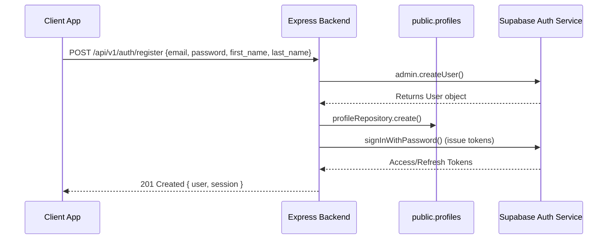

# Authentication & Session Guide

This document describes the authentication flow, token lifecycle, and account state checks implemented in the Nowhere Esports Intranet backend.

---

## Technical Stack & Flow

We integrate directly with **Supabase Auth**. The backend does not store passwords or manage raw password reset tokens; instead, it delegates auth session state, signup verification, and recovery token exchanges to the Supabase Auth Service.

---

## Token Lifecycle

- **Access Token**: JWT containing the user's details and metadata. Transmitted in the `Authorization: Bearer <token>` header. Token validation is performed via `supabaseAdmin.auth.getUser()`, ensuring session revocation checks are applied.
- **Refresh Token**: Long-lived token used to obtain a new Access Token. Submitted via `POST /api/v1/auth/refresh`.

---

## Endpoint Specifications

### 1. Register User
`POST /api/v1/auth/register`
- **Rate Limit**: Stricter 10 requests / 15 minutes.
- **Role**: Automatically defaults to `employee`.
- **Validation**: Email validation, name length, and password policy (minimum 8 characters, at least one uppercase, one digit, and one special character).

### 2. Login User
`POST /api/v1/auth/login`
- **Rate Limit**: Stricter 10 requests / 15 minutes.
- **Verification**: Validates credentials. On success, queries the `public.profiles` database to check status:
  - If status is `inactive`, blocks login with a `401 Unauthorized` error.
  - If status is `suspended`, blocks login with a `401 Unauthorized` error.

### 3. Logout User
`POST /api/v1/auth/logout`
- **Access**: Requires authentication.
- **Behavior**: Calls Supabase global sign out, invalidating all active sessions for the user.

### 4. Forgot Password
`POST /api/v1/auth/forgot-password`
- **Anti-Enumeration**: Always returns `200 OK` with a success message regardless of whether the email exists.
- **Behavior**: Triggers a recovery email link.

### 5. Reset Password
`POST /api/v1/auth/reset-password`
- **Behavior**: Accepts a recovery token and updates the user's password.

### 6. Refresh Session
`POST /api/v1/auth/refresh`
- **Behavior**: Accepts a refresh token and yields a new token pair.
