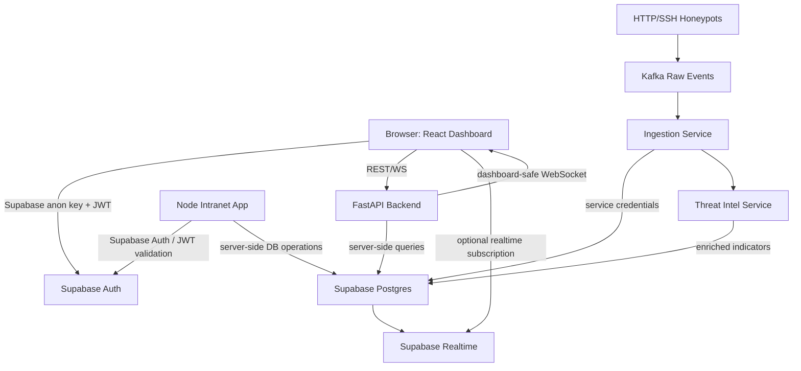

# TRD: Supabase Architecture

## Target architecture

## Components

### Supabase Auth
Handles identity for users/admins/analysts. It replaces custom OTP token storage where possible.

### Supabase Postgres
System of record for:
- user profiles
- roles
- teams
- matches
- announcements
- attack events
- enrichment results
- rules
- alerts
- audit logs
- health checks

### Supabase Realtime
Used for dashboard-safe events:
- new attack summaries
- alert status changes
- match score changes
- announcement publications

For high-volume raw traffic, do not stream every raw packet to the browser. Use summarized rows or backend-filtered WebSocket channels.

### FastAPI backend
Primary backend API for the VIGILANCE platform. It should:
- validate JWTs
- enforce role-level business rules
- query Supabase Postgres
- expose dashboard APIs
- optionally broadcast platform WebSocket updates
- never expose service credentials

### Node intranet app
Target vulnerable web application. It should:
- stop using MongoDB/Mongoose after migration
- use Supabase client/server SDK or Postgres client
- validate Supabase Auth JWTs
- call controlled internal endpoints for honeypot event logging

## Data boundaries

| Data type | Browser access | Backend access | Notes |
|---|---:|---:|---|
| Own profile | Yes | Yes | RLS restricts ownership |
| Public announcements | Yes | Yes | Published only |
| Matches | Yes | Yes | Role-aware update |
| Raw attack payload | No | Yes | Avoid browser exposure |
| Attack summaries | Analyst/Admin only | Yes | RLS + backend |
| Threat intel | Analyst/Admin only | Yes | API-key results sanitized |
| Audit logs | Admin only | Yes | Append-only |
| System health | Admin/Analyst read | Service write | No public writes |

## Database access modes

### Browser
- `SUPABASE_URL`
- `SUPABASE_ANON_KEY`
- User JWT
- RLS-protected access only

### Backend services
- `SUPABASE_URL`
- `SUPABASE_SERVICE_ROLE_KEY` or direct Postgres connection string
- Never commit secrets

### Local dev
- Supabase local stack
- Migration files
- Seed file
- `.env.local`

## Non-negotiable security rules

1. RLS must be enabled on all public tables.
2. `service_role` key must never appear in frontend code.
3. Attack event insertion must be server-side only.
4. Raw payloads should be size-limited and sanitized.
5. External enrichment keys must stay in backend services only.
6. Audit logs should be append-only from application code.
